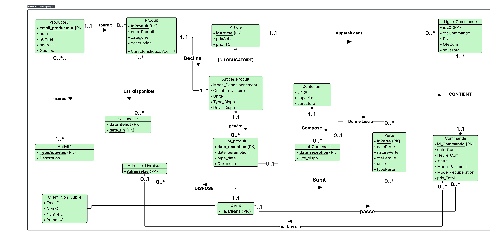

# Au Valaisan - Système de Gestion de Base de Données & Démonstrateur JDBC

[](https://openjdk.org/)
[](https://www.oracle.com/database/)
[](https://maven.apache.org/)
[](LICENSE)
[](https://ensimag.grenoble-inp.fr/)

---

## Sommaire

- [Présentation du Projet](#présentation-du-projet)
- [Contexte Académique & Auteurs](#contexte-académique--auteurs)
- [Fonctionnalités Principales](#fonctionnalités-principales)
- [Modélisation & Schéma Relationnel](#modélisation--schéma-relationnel)
- [Gestion des Transactions et de la Concurrence](#gestion-des-transactions-et-de-la-concurrence)
- [Architecture du Code Source](#architecture-du-code-source)
- [Prérequis et Dépendances](#prérequis-et-dépendances)
- [Configuration de la Connexion Oracle](#configuration-de-la-connexion-oracle)
- [Compilation et Exécution](#compilation-et-exécution)
- [Structure des Scripts SQL](#structure-des-scripts-sql)
- [Documentation Technique](#documentation-technique)
- [Licence](#licence)

---

## Présentation du Projet

Ce projet a pour objectif la modélisation, la conception et l'implémentation d'un système de gestion de base de données relationnelle complet pour l'épicerie fine et vrac **« Au Valaisan »**, complété par un démonstrateur interactif développé en **Java** via l'API **JDBC**.

Le système centralise l'ensemble de la chaîne opérationnelle :
- Référencement des producteurs locaux et de leurs activités (géolocalisation, contact, spécialités).
- Gestion fine des produits vendus au **vrac** ou en **pré-conditionné**, ainsi que des **contenants** réutilisables ou jetables.
- Suivi rigoureux des stocks découpés en **lots** identifiés par date de réception, avec gestion stricte de la **DLC (Date Limite de Consommation)** ou de la **DLUO (Date Limite d'Utilisation Optimale)** (mutuellement exclusives).
- Gestion de la **saisonnalité** multi-périodes des denrées périssables.
- Traitement transactionnel des **commandes**, des **adresses de livraison**, des **modes de paiement**, des **alertes de péremption**, des **promotions automatiques (-50%)** et des **déclarations de pertes** (casse, avarie, vol).
- Respect du **droit à l'oubli (RGPD)** tout en assurant l'obligation légale de conservation des historiques de facturation sur 10 ans.

---

## Contexte Académique & Auteurs

Projet réalisé dans le cadre du cursus d'ingénieur à **Grenoble INP - Ensimag** (Université Grenoble Alpes), filière **Modélisation Mathématique, Image et Simulation (MMIS)**, pour le cours de *Bases de Données Relationnelles*.

- **Auteurs** :
  - **Ayoub TOUATI**
  - **Marwane HAJJY**
  - **Mouad EL-LAHOUA**
  - **Marouane EL HADARI**
  - **Maximilien RAGOT**
- **Encadrement** : **Mme NOHA Ibrahim**
- **Année Universitaire** : 2024-2025 / 2025-2026

---

## Fonctionnalités Principales

Le système propose deux interfaces interactives distinctes et un service d'arrière-plan autonome :

### 1. Espace Client (`UtilisateurApp`)
- Exploration interactive du catalogue hiérarchisé par rayons (Légumes, Fruits, Produits Laitiers, Boulangerie, Boissons, Épicerie, Contenants).
- Consultation des produits de saison et des articles en promotion (ventes flash anti-gaspillage sur les lots proches de la péremption).
- Inscription et gestion de compte avec respect du droit à l'oubli.
- Gestion du carnet d'adresses de livraison.
- Panier dynamique multi-articles avec calcul temps réel des sous-totaux et taxes.
- Validation transactionnelle de commande avec choix du mode de livraison et de paiement.
- Suivi et annulation des commandes en cours de préparation.

### 2. Espace Épicier / Gérant (`EpicierApp`)
- Dashboard temps réel des **alertes de péremption** (lots expirant dans les 10 jours ou déjà périmés).
- Traitement et clôture des commandes (mise à jour du cycle de vie : *En Préparation* &rarr; *Prête* &rarr; *En Livraison* &rarr; *Récupérée | Livrée*).
- **Déclaration de pertes** avec déstockage automatique des lots selon la politique FIFO (*First In, First Out*).
- Gestion globale du catalogue : ajout de producteurs, de produits, de conditionnements et réapprovisionnement de lots.

### 3. Démon de Surveillance (`SystemeEpicerie`)
- Processus d'arrière-plan effectuant une veille périodique (toutes les 30 secondes).
- Détection continue des stocks périmés ou critiques afin de lever les alertes et d'activer automatiquement les promotions tarifaires.

---

## Modélisation & Schéma Relationnel

La modélisation repose sur une formalisation rigoureuse en **Entité/Associations (E/A)** traduite en schéma relationnel normalisé en **3NF / BCNF**.



### Relations Principales

| Relation | Rôle Métier | Clé Primaire |
| :--- | :--- | :--- |
| `Producteur` | Producteurs locaux partenaires | `email_producteur` |
| `Produit` | Produits de base fournis par les producteurs | `IdProduit` |
| `Article` | Super-type unifié de tout élément commercialisable | `IdArticle` |
| `Art_Pdt` | Spécialisation denrée alimentaire (vrac ou pré-conditionné) | `IdArticle` |
| `Contenant` | Spécialisation contenant (bocaux, sachets kraft...) | `IdArticle` |
| `Lot_Produit` | Stock physiquement réceptionné d'un produit alimentaire | `(IdArticle, date_reception)` |
| `Lot_Contenant`| Stock réceptionné d'un type de contenant | `(IdArticle, date_reception)` |
| `Commande` | En-tête de commande et statut | `IdCommande` |
| `Ligne_Commande` | Détail des articles et quantités commandés | `(IdCommande, IdLC)` |
| `Client` | Identifiant anonyme (conservation légale 10 ans) | `IdClient` |
| `Client_Non_Oublie` | Données nominatives et coordonnées du client (RGPD) | `IdClient` |
| `Perte` | Registre des pertes (casse, vol, péremption) | `IdPerte` |

Pour une analyse exhaustive des dépendances fonctionnelles, formes normales et contraintes de domaine, consulter la [Documentation du Schéma Relationnel](docs/relational-model.md).

---

## Gestion des Transactions et de la Concurrence

Le système garantit les propriétés **ACID** grâce à :
1. **Désactivation de l'autocommit** : Toutes les écritures critiques (`INSERT`, `UPDATE`, `DELETE`) s'exécutent dans des blocs transactionnels explicites avec `COMMIT` final ou `ROLLBACK` systématique en cas d'incident.
2. **Verrouillage Pessimiste FIFO** : Utilisation de clauses `SELECT ... FOR UPDATE` triées par `date_reception ASC` pour consommer en priorité les lots les plus anciens tout en verrouillant la ligne contre les accès concurrents.
3. **Mécanisme Anti-Survente** : Vérification stricte des quantités disponibles au moment du déstockage (`UPDATE Lot_Produit SET Qte_dispo = Qte_dispo - :qte WHERE Qte_dispo >= :qte`).
4. **Prévention des Interblocages** : Tri canonique des articles par identifiant croissant avant la pose de verrous.

Détails complets et diagrammes de séquence disponibles dans le [Guide des Transactions et Concurrence](docs/transactions-concurrency.md).

---

## Architecture du Code Source

```
.
├── pom.xml                               # Configuration Apache Maven 3.8+
├── Makefile                              # Commandes de build et execution rapides
├── .gitignore                            # Exclusion des binaires et secrets
├── .gitattributes                        # Normalisation des fins de lignes (LF)
├── LICENSE                               # Licence Open-Source MIT
├── CONTRIBUTING.md                       # Guide de contribution et normes de code
├── CODE_OF_CONDUCT.md                    # Code de conduite des contributeurs
├── README.md                             # Documentation principale du projet
│
├── src/main/
│   ├── java/jdbc/                        # Sources Java JDBC
│   │   ├── EpicierApp.java               # Point d'entree Espace Epicier / Gerant
│   │   ├── UtilisateurApp.java           # Point d'entree Espace Client
│   │   ├── SystemeEpicerie.java          # Demon de surveillance des peremptions
│   │   ├── MenuApp.java                  # Moteur interactif des menus et logique metier
│   │   └── OracleDB.java                 # Gestion de la connexion JDBC et requetes
│   └── resources/
│       └── db.properties.example         # Gabarit de configuration des identifiants
│
├── sql/
│   ├── creation_insertion/
│   │   └── schema.sql                    # Script DDL de creation et peuplement initial
│   └── fonctionnalite/                   # Transactions SQL de reference
│       ├── alertes_peremption.sql        # Requetes de detection des lots a date limite
│       ├── cloturer_commande.sql         # Transaction de cloture et destockage FIFO
│       ├── declarer_perte.sql            # Transaction de declaration de perte FIFO
│       └── passer_commande.sql           # Transaction de creation de commande
│
├── libs/
│   └── ojdbc17.jar                       # Pilote officiel Oracle JDBC Thin Driver
│
├── scripts/
│   ├── compile.sh                        # Script POSIX de compilation (Maven / javac)
│   ├── run-client.sh                     # Lanceur Espace Client
│   ├── run-epicier.sh                    # Lanceur Espace Epicier
│   ├── run-systeme.sh                    # Lanceur Demon de surveillance
│   └── init-db.sh                        # Script d'aide au peuplement Oracle
│
└── docs/
    ├── Documentation_ProjetBD.pdf        # Rapport officiel complet du projet (PDF)
    ├── Projet_BD_2025_2026.pdf           # Sujet et cahier des charges officiel (PDF)
    ├── relational-model.md               # Details du modele relationnel et DDL
    ├── transactions-concurrency.md       # Analyse detaillee des transactions
    ├── architecture.md                   # Architecture logicielle et composants
    └── images/
        └── diagramme_conceptuel_ea.png   # Diagramme conceptuel haute resolution
```

---

## Prérequis et Dépendances

- **Java Development Kit (JDK)** : Version 17 ou supérieure (testé sous OpenJDK 17, 21 et 25).
- **Base de données** : Oracle Database 19c ou 21c (accès aux serveurs Ensimag `oracle1.ensimag.fr` ou instance locale Oracle XE / Free / Docker).
- **Gestionnaire de build** : [Apache Maven 3.8+](https://maven.apache.org/) ou `make` avec `javac` standard.
- **Pilote JDBC** : Oracle Thin Driver inclus (`libs/ojdbc17.jar`).

---

## Configuration de la Connexion Oracle

Pour protéger vos identifiants sur GitHub, la classe `OracleDB` utilise une résolution à plusieurs niveaux.

### Méthode 1 : Variables d'environnement (Recommandée)
```bash
export ORACLE_URL="jdbc:oracle:thin:@oracle1.ensimag.fr:1521:oracle1"
export ORACLE_USER="votre_login"
export ORACLE_PASSWORD="votre_mot_de_passe"
```

### Méthode 2 : Fichier de propriétés local
Copier le fichier d'exemple à la racine du projet (ce fichier est ignoré par Git) :
```bash
cp src/main/resources/db.properties.example db.properties
```
Puis éditer `db.properties` avec vos identifiants :
```properties
db.url=jdbc:oracle:thin:@oracle1.ensimag.fr:1521:oracle1
db.user=mon_login
db.password=mon_mot_de_passe
```

### Méthode 3 : Repli par défaut
Si aucun paramètre n'est renseigné, la classe se connecte automatiquement sur l'instance pédagogique `oracle1.ensimag.fr` avec les identifiants Ensimag par défaut.

---

## Compilation et Exécution

### 1. Compilation

Avec **Make** :
```bash
make compile
```

Ou avec **Apache Maven** :
```bash
mvn compile
```

Ou via le script portable :
```bash
./scripts/compile.sh
```

---

### 2. Initialisation de la Base de Données

Pour exécuter le script DDL et peupler la base avec les données de test :
```bash
./scripts/init-db.sh
```
Ou manuellement via SQL*Plus :
```bash
sqlplus $ORACLE_USER/$ORACLE_PASSWORD@oracle1.ensimag.fr:1521:oracle1 @sql/creation_insertion/schema.sql
```

---

### 3. Lancement des Applications

#### Espace Client (Utilisateur)
```bash
make run-client
# ou : ./scripts/run-client.sh
# ou : mvn exec:java@client
```

#### Espace Épicier (Gestionnaire)
```bash
make run-epicier
# ou : ./scripts/run-epicier.sh
# ou : mvn exec:java@epicier
```

#### Démon de Surveillance des Péremptions
```bash
make run-systeme
# ou : ./scripts/run-systeme.sh
# ou : mvn exec:java@systeme
```

---

## Structure des Scripts SQL

| Script SQL | Description |
| :--- | :--- |
| [`sql/creation_insertion/schema.sql`](sql/creation_insertion/schema.sql) | DDL complet : suppression des tables, création des tables, contraintes d'intégrité (`PK`, `FK`, `CHECK`, `UNIQUE`), puis insertion du jeu d'essai complet. |
| [`sql/fonctionnalite/passer_commande.sql`](sql/fonctionnalite/passer_commande.sql) | Transaction complète d'enregistrement d'une commande client, insertion des lignes et rattachement de l'adresse de livraison. |
| [`sql/fonctionnalite/declarer_perte.sql`](sql/fonctionnalite/declarer_perte.sql) | Transaction de déclaration de perte avec verrouillage pessimiste et déduction FIFO sur les lots de stock. |
| [`sql/fonctionnalite/cloturer_commande.sql`](sql/fonctionnalite/cloturer_commande.sql) | Transaction de préparation et clôture de commande avec déstockage effectif et contrôle anti-survente. |
| [`sql/fonctionnalite/alertes_peremption.sql`](sql/fonctionnalite/alertes_peremption.sql) | Requêtes d'analyse des lots périmés ou approchant de la DLC/DLUO dans une fenêtre de 10 jours. |

---

## Documentation Technique

Des documents approfondis sont disponibles dans le dossier [`docs/`](docs/) :
- [Rapport Académique Officiel (PDF)](docs/Documentation_ProjetBD.pdf)
- [Cahier des Charges & Sujet Officiel (PDF)](docs/Projet_BD_2025_2026.pdf)
- [Documentation du Schéma Relationnel](docs/relational-model.md)
- [Documentation des Transactions & Concurrence](docs/transactions-concurrency.md)
- [Architecture Logicielle et Composants](docs/architecture.md)

---

## Licence

Ce projet est distribué sous licence libre **MIT**. Consulter le fichier [LICENSE](LICENSE) pour plus d'informations.
