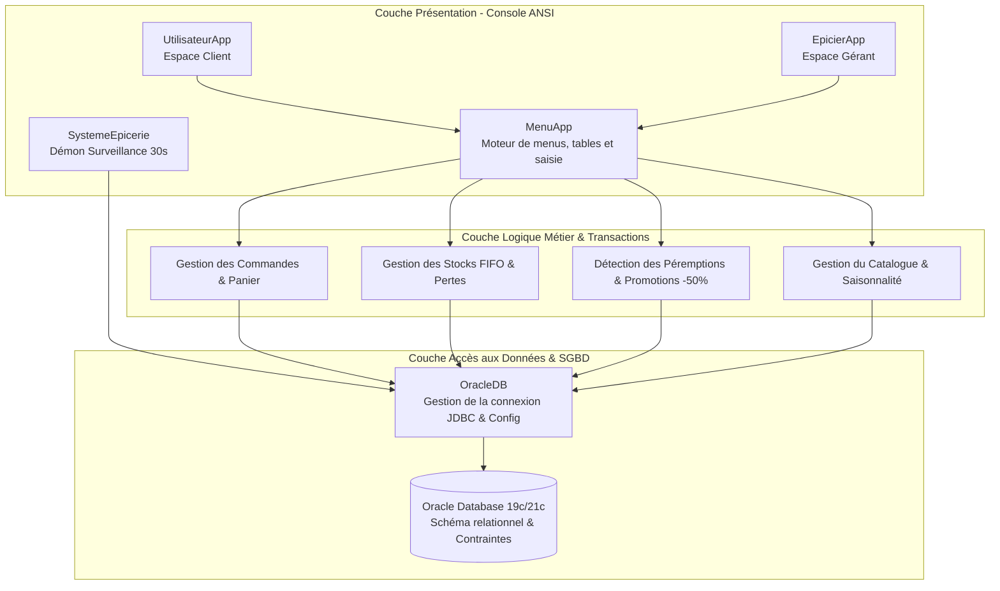
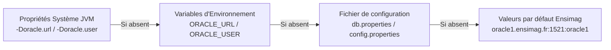

# Architecture Technique du Système

Ce document décrit l'architecture globale du démonstrateur Java JDBC et son interaction avec le SGBD relationnel Oracle pour l'épicerie « Au Valaisan ».

---

## 1. Vue d'Ensemble des Composants

L'architecture est structurée en trois couches principales assurant une séparation claire entre présentation console, logique métier transactionnelle et persistance relationnelle :

---

## 2. Rôles des Modules Java

| Classe Java | Rôle et Responsabilités |
| :--- | :--- |
| `jdbc.UtilisateurApp` | Point d'entrée de l'application cliente. Initie la session utilisateur, l'exploration des catalogues par rayon, le panier et le passage de commande. |
| `jdbc.EpicierApp` | Point d'entrée de l'espace d'administration de l'épicier. Permet la gestion des commandes (clôture/statuts), déclaration des pertes, ajout de produits et réapprovisionnements. |
| `jdbc.SystemeEpicerie` | Démon autonome exécutant un cycle de surveillance périodique (toutes les 30 secondes). Il scrute les lots proches de la date limite (marge de tolérance de 7 à 10 jours) et maintient à jour le registre des alertes. |
| `jdbc.MenuApp` | Cœur applicatif regroupant le moteur de navigation ANSI (compatible terminaux Linux/macOS/Windows), le formatage tabulaire dynamique avec calcul automatique de largeurs de colonnes, et les flux de contrôle transactionnels. |
| `jdbc.OracleDB` | Gestionnaire de persistance JDBC. Il gère la configuration dynamique (variables d'environnement, fichiers de propriétés, repli par défaut) et propose des utilitaires d'affichage tabulaire et de requêtes préparées. |

---

## 3. Gestion de la Configuration de Connexion

La classe `OracleDB` résout les paramètres de connexion selon la chaîne de priorité suivante :

Ce mécanisme garantit :
1. Une portabilité totale sur n'importe quel serveur Oracle (local Docker, cloud ou académique).
2. La protection des identifiants sensibles lors du déploiement public sur GitHub.
3. Une exécution directe sans configuration additionnelle dans l'environnement de l'Ensimag.
