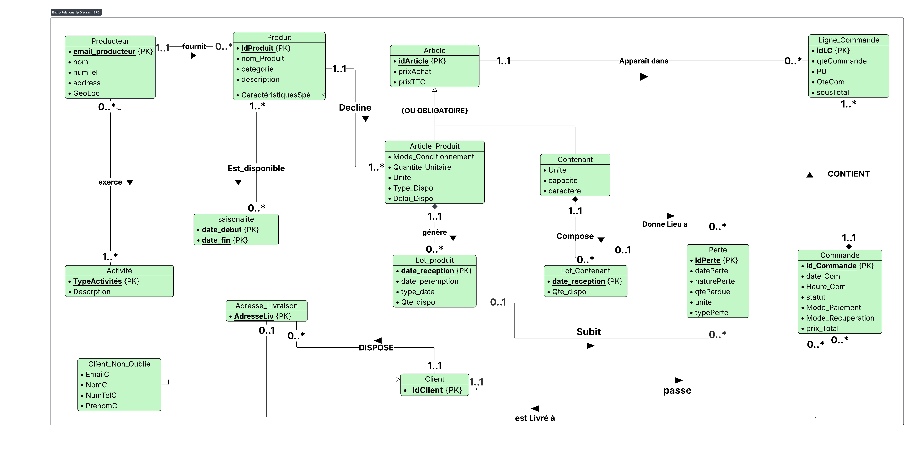

# Modélisation Conceptuelle et Schéma Relationnel

Ce document détaille l'analyse conceptuelle, le modèle Entité/Associations (E/A), les règles de passage au relationnel ainsi que l'ensemble des tables et contraintes d'intégrité définissant le SGBD de l'épicerie **Au Valaisan**.

---

## 1. Contexte et Hypothèses de Modélisation

L'épicerie « Au Valaisan » est spécialisée dans la vente de produits locaux et en vrac. Les choix de conception répondent aux exigences suivantes :

| Exigence Métier | Choix de Modélisation Retenu | Justification |
| :--- | :--- | :--- |
| **Généralisation des ventes** | Entité générique `Article` avec sous-types `Art_Pdt` et `Contenant`. | Permet un traitement homogène des prix, calculs de TVA, stocks et lignes de commande. |
| **Unicité des lots par date** | Clé primaire composite `(IdArticle, date_reception)` pour les lots. | Hypothèse du cahier des charges : au maximum une livraison par jour pour un produit donné. |
| **Exclusivité DLC / DLUO** | Contrainte `CHECK (type_date IN ('DLC', 'DLUO'))` avec une seule date. | Un lot ne peut pas posséder simultanément une DLC et une DLUO. |
| **Droit à l'oubli (RGPD) & Conservation légale** | Séparation `Client(IdClient)` et `Client_Non_Oublie(IdClient, Nom, Prenom, Email...)`. | Conservation légale de 10 ans des factures/commandes sans conserver de données personnelles en cas d'effacement. |
| **Saisonnalité dynamique** | Association n-aire `Est_Disponible` reliée à `Saisonalite(date_debut, date_fin)`. | Un produit peut être disponible sur 0, 1 ou plusieurs périodes annuelles disjointes. |

---

## 2. Diagramme Conceptuel Entité/Associations

Le modèle conceptuel a été validé selon le formalisme UML/Entité-Associations de l'Ensimag.

---

## 3. Traduction vers le Modèle Relationnel

La démarche retenue pour la traduction suit rigoureusement les étapes de normalisation :

### 3.1 Entités Simples
- **Producteur** (`email_producteur` [PK], `nom`, `numTel`, `address`, `GeoLoc`)
- **Activité** (`TypeActivité` [PK], `Description`)
- **Produit** (`IdProduit` [PK], `nom_Produit`, `categorie`, `description`, `CaracteristiquesSpe`, `email_Producteur` [FK])
- **Saisonalite** (`date_debut` [PK], `date_fin` [PK]) avec `CHECK (date_debut < date_fin)`
- **Article** (`IdArticle` [PK], `prixAchat`, `prixTTC`) avec `CHECK (prixAchat > 0 AND prixTTC > 0)`
- **Perte** (`IdPerte` [PK], `datePerte`, `naturePerte`, `typePerte`, `qtePerdue`, `unite`)
- **Client** (`IdClient` [PK])
- **Adresse_Livraison** (`AdresseLiv` [PK], `IdClient` [FK])
- **Commande** (`IdCommande` [PK], `date_Com`, `Heure_Com`, `Prix_Total`, `Statut`, `Mode_Paiement`, `Mode_Recuperation`, `IdClient` [FK])

### 3.2 Spécialisation / Sous-types (Méthode par Référence)
La méthode par référence a été retenue : chaque table sous-type partage la même clé primaire qui est également clé étrangère vers l'entité mère :
- **Art_Pdt** (`IdArticle` [PK, FK], `IdProduit` [FK], `Mode_Conditionnement`, `Quantite_Unitaire`, `Unite`, `Delai_Dispo`, `Type_Dispo`)
  * `CHECK (Mode_Conditionnement IN ('Vrac', 'Pré-Conditionné'))`
  * `CHECK (Type_Dispo IN ('Sur Commande', 'En Stock', 'Sur Commande et En Stock'))`
- **Contenant** (`IdArticle` [PK, FK], `Type`, `Capacite`, `Unite`, `Caractere`)
  * `CHECK (Caractere IN ('Réutilisable', 'Jetable'))`
  * `CHECK (Unite IN ('L', 'g'))`
- **Client_Non_Oublie** (`IdClient` [PK, FK], `NomC`, `PrenomC`, `NumTelC`, `EmailC` [UNIQUE])

### 3.3 Entités Faibles et Associations
- **Lot_Produit** (`IdArticle` [PK, FK], `date_reception` [PK], `date_peremption`, `type_date`, `Qte_dispo`)
  * `CHECK (type_date IN ('DLC', 'DLUO'))`
- **Lot_Contenant** (`IdArticle` [PK, FK], `date_reception` [PK], `Qte_dispo`)
- **Ligne_Commande** (`IdCommande` [PK, FK], `IdLC` [PK], `IdArticle` [FK], `QteCom`, `PU`, `Sous_Total`)
- **Est_Disponible** (`IdProduit` [PK, FK], `date_debut` [PK, FK], `date_fin` [PK, FK])
- **Exerce** (`email_producteur` [PK, FK], `type_activite` [PK, FK])
- **Subit** (`IdPertes` [PK, FK], `IdArticle` [FK], `date_reception` [FK])
- **Donne_Lieu_A** (`IdPertes` [PK, FK], `IdArticle` [FK], `date_reception` [FK])
- **Est_Livrée_A** (`IdCommande` [PK, FK], `AdresseLiv` [FK])

---

## 4. Analyse des Formes Normales

Toutes les relations du schéma vérifient la **Troisième Forme Normale (3NF)** et la **Forme Normale de Boyce-Codd (BCNF)** :
1. **1NF** : Tous les attributs sont atomiques (pas de répétitions ni de champs multivalués).
2. **2NF** : Tout attribut non-clé dépend pleinement de l'intégralité de la clé primaire (aucune dépendance partielle sur les clés composites telles que `(IdArticle, date_reception)` ou `(IdCommande, IdLC)`).
3. **3NF** : Aucune dépendance transitive entre attributs non-clés.
4. **BCNF** : Pour toute dépendance fonctionnelle $X \to Y$, $X$ est une super-clé.
