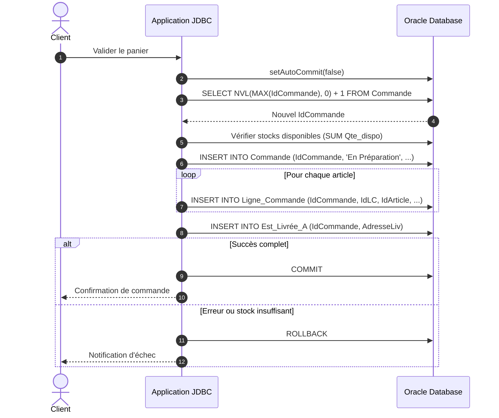

# Gestion des Transactions et de la Concurrence

Ce document explicite la conception des transactions critiques au sein du SGBD de l'épicerie « Au Valaisan », les niveaux d'isolation retenus, la politique de verrouillage pessimiste et la prévention des anomalies concurrentes.

---

## 1. Principes et Propriétés ACID

L'ensemble des opérations d'écriture et de mise à jour des stocks est soumis aux propriétés ACID :
- **Atomicité** : Désactivation explicite du mode `auto-commit` (`conn.setAutoCommit(false)`). Toute défaillance (stock insuffisant, rupture de contrainte) déclenche un `ROLLBACK` intégral.
- **Cohérence** : Les contraintes d'intégrité référentielle (`FOREIGN KEY ... ON DELETE CASCADE`), les contraintes de domaine (`CHECK`) et les vérifications applicatives garantissent un état valide de la base.
- **Isolation** : Verrouillage pessimiste (`SELECT ... FOR UPDATE`) sur les lignes critiques de stocks (`Lot_Produit`) afin d'éliminer les lectures incohérentes et les pertes de mises à jour.
- **Durabilité** : Les modifications validées par `COMMIT` sont persistées de manière permanente sur le serveur Oracle.

---

## 2. Analyse des Trois Transactions Critiques

### 2.1 Fonctionnalité 1 : Passage d'une Commande Client

Lorsqu'un client valide son panier, la transaction doit orchestrer la création de la commande et de toutes ses dépendances sans laisser d'états partiels :



### 2.2 Fonctionnalité 2 : Alertes de Péremption et Déclaration de Pertes

Les pertes (casse, vol, dégradation, date de péremption dépassée) doivent déstocker physiquement les articles selon la règle **FIFO (First In, First Out)** :

```sql
-- 1. Début de transaction
BEGIN;

-- 2. Insertion de la perte constatée
INSERT INTO Perte(IdPerte, datePerte, naturePerte, typePerte, qtePerdue, unite)
VALUES (2001, CURRENT_DATE, 'Casse', 'Article', 3, 'kg');

-- 3. Verrouillage pessimiste ordonné FIFO des lots concernés
SELECT date_reception, Qte_dispo
FROM Lot_Produit
WHERE IdArticle = 10
ORDER BY date_reception
FOR UPDATE;

-- 4. Décrémentation conditionnelle du lot le plus ancien
UPDATE Lot_Produit
SET Qte_dispo = Qte_dispo - 3
WHERE IdArticle = 10
  AND date_reception = TO_DATE('2025-11-05', 'YYYY-MM-DD')
  AND Qte_dispo >= 3;

-- 5. Validation atomique
COMMIT;
```

> **Mécanisme Anti-Survente** : La clause `AND Qte_dispo >= :quantite` dans l'`UPDATE` garantit qu'aucun stock ne peut devenir négatif, même sous forte concurrence. Si le nombre de lignes modifiées est nul, la transaction bascule sur le lot suivant ou exécute un `ROLLBACK`.

### 2.3 Fonctionnalité 3 : Clôture et Transition d'États de Commande

Le cycle de vie d'une commande évolue selon un automate d'états fini :
`En Préparation` $\to$ `Prête` $\to$ `En Livraison` $\to$ `Récupérée | Livrée` (ou `Annulée`).

Au moment du passage à l'état `Prête` :
1. Les lots de chaque article de la commande sont verrouillés via `SELECT ... FOR UPDATE ORDER BY date_reception`.
2. Les quantités sont décrémentées des lots FIFO.
3. Si le stock est insuffisant lors de la préparation, la commande est annulée avec notification.
4. Si les décrémentations réussissent, le statut est mis à jour à `'Prête'` et la transaction est validée par `COMMIT`.

---

## 3. Gestion de la Concurrence et Prévention des Interblocages (Deadlocks)

Pour éviter les interblocages lors de l'accès concurrent à plusieurs articles :
1. **Ordre canonique d'acquisition des verrous** : Les articles dans une même commande sont toujours triés par `IdArticle` croissant avant d'émettre les clauses `FOR UPDATE`.
2. **Ordre temporel FIFO** : Les lots d'un même article sont systématiquement triés par `date_reception ASC`.
3. **Niveau d'isolation** :
   - Par défaut, Oracle applique le niveau `READ COMMITTED`.
   - Les lectures avec verrouillage (`FOR UPDATE`) assurent que les écritures concurrentes attendent la fin de la transaction en cours sans écrasement de données (*lost updates*).
